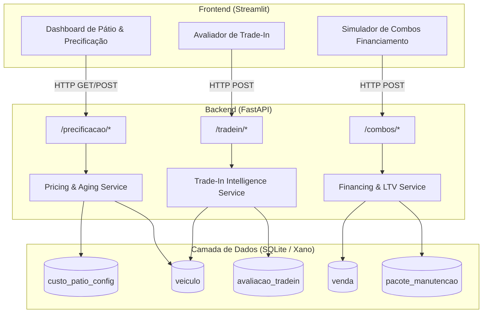
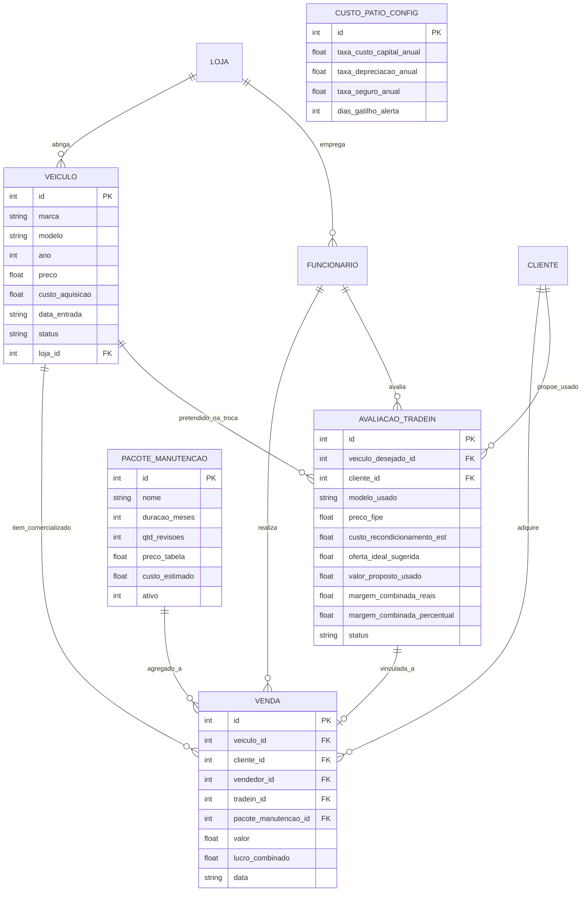

# Design: Motor de Precificação Dinâmica & Trade-In com Inteligência de Margem

## 1. Contexto e Decisões de Arquitetura

O sistema adota uma arquitetura em 3 camadas alinhada com as diretrizes do projeto:
* **Backend:** FastAPI (Python), responsável por centralizar 100% das regras financeiras, validações Pydantic, algoritmos de cálculo e orquestração.
* **Banco de Dados & Persistência:** Modelo relacional simulando o Xano (via SQLite `concessionaria.db` no ambiente local/FastAPI), mantendo compatibilidade com XanoScript.
* **Frontend:** Streamlit (Python), agindo como uma camada puramente cliente/consumidora via REST HTTP, sem lógica de negócio duplicada.



---

## 2. Esquema de Banco de Dados e Entidades

### 2.1 Alterações em Tabelas Existentes

#### Tabela `veiculo`
Extensão de campos para suportar o rastreamento temporal e custo base de aquisição:
```sql
ALTER TABLE veiculo ADD COLUMN custo_aquisicao REAL NOT NULL DEFAULT 0.0;
ALTER TABLE veiculo ADD COLUMN data_entrada TEXT DEFAULT (datetime('now'));
ALTER TABLE veiculo ADD COLUMN preco_original REAL DEFAULT 0.0;
```

#### Tabela `venda`
Extensão de campos para associar a operação de trade-in, pacote de manutenção e lucro consolidado:
```sql
ALTER TABLE venda ADD COLUMN tradein_id INTEGER NULL REFERENCES avaliacao_tradein(id);
ALTER TABLE venda ADD COLUMN pacote_manutencao_id INTEGER NULL REFERENCES pacote_manutencao(id);
ALTER TABLE venda ADD COLUMN lucro_combinado REAL DEFAULT 0.0;
```

---

### 2.2 Novas Tabelas / Coleções

#### 1. `custo_patio_config`
Configurações de taxas anuais e parâmetros para o cálculo de depreciação e alertas de aging.
```sql
CREATE TABLE IF NOT EXISTS custo_patio_config (
    id INTEGER PRIMARY KEY AUTOINCREMENT,
    taxa_custo_capital_anual REAL NOT NULL DEFAULT 0.12,  -- 12% a.a.
    taxa_depreciacao_anual REAL NOT NULL DEFAULT 0.15,    -- 15% a.a.
    taxa_seguro_anual REAL NOT NULL DEFAULT 0.012,        -- 1.2% a.a.
    dias_gatilho_alerta INTEGER NOT NULL DEFAULT 30,      -- 30 dias
    atualizado_em TEXT DEFAULT (datetime('now'))
);
```

#### 2. `avaliacao_tradein`
Registro de avaliações técnicas e financeiras de seminovos recebidos na troca vinculados à negociação.
```sql
CREATE TABLE IF NOT EXISTS avaliacao_tradein (
    id INTEGER PRIMARY KEY AUTOINCREMENT,
    cliente_id INTEGER,
    veiculo_desejado_id INTEGER NOT NULL,
    vendedor_id INTEGER NOT NULL,
    marca_usado TEXT NOT NULL,
    modelo_usado TEXT NOT NULL,
    ano_usado INTEGER NOT NULL,
    km_usado INTEGER NOT NULL,
    preco_fipe REAL NOT NULL,
    custo_recondicionamento_est REAL NOT NULL DEFAULT 0.0,
    oferta_ideal_sugerida REAL NOT NULL,
    valor_proposto_usado REAL NOT NULL,
    overallowance REAL NOT NULL DEFAULT 0.0,
    lucro_veiculo_novo REAL NOT NULL,
    margem_futura_usado REAL NOT NULL,
    margem_combinada_reais REAL NOT NULL,
    margem_combinada_percentual REAL NOT NULL,
    status TEXT NOT NULL DEFAULT 'em_analise', -- 'em_analise', 'aprovado', 'recusado'
    criado_em TEXT DEFAULT (datetime('now')),
    FOREIGN KEY(cliente_id) REFERENCES cliente(id),
    FOREIGN KEY(veiculo_desejado_id) REFERENCES veiculo(id),
    FOREIGN KEY(vendedor_id) REFERENCES funcionario(id)
);
```

#### 3. `pacote_manutencao`
Catálogo de serviços e combos pré-pagos de manutenção para agregação em financiamentos.
```sql
CREATE TABLE IF NOT EXISTS pacote_manutencao (
    id INTEGER PRIMARY KEY AUTOINCREMENT,
    nome TEXT NOT NULL,
    duracao_meses INTEGER NOT NULL,
    qtd_revisoes INTEGER NOT NULL,
    preco_tabela REAL NOT NULL,
    custo_estimado REAL NOT NULL,
    descricao TEXT,
    ativo INTEGER NOT NULL DEFAULT 1
);
```

---

### 2.3 Diagrama de Entidade-Relacionamento (ERD)



---

## 3. Contratos de API (FastAPI REST)

### 3.1 Módulo de Precificação e Gestão de Pátio

#### `GET /precificacao/patio/dashboard`
Retorna visão geral de liquidez, custo total de carregamento e veículos com alerta de estagnação.

* **Response (200 OK):**
```json
{
  "total_veiculos_patio": 42,
  "custo_total_carregamento_dia": 2845.50,
  "custo_acumulado_patio_total": 67320.00,
  "veiculos_alerta_contagem": 8,
  "itens": [
    {
      "veiculo_id": 1,
      "marca": "Toyota",
      "modelo": "Corolla",
      "ano": 2023,
      "preco_atual": 120000.0,
      "custo_aquisicao": 105000.0,
      "data_entrada": "2026-09-10T10:00:00",
      "dias_em_estoque": 46,
      "custo_diario": 81.12,
      "custo_patio_acumulado": 3731.52,
      "status_aging": "ALERTA_VERMELHO",
      "desconto_sugerido": 4664.40,
      "novo_preco_sugerido": 115335.60
    }
  ]
}
```

#### `POST /precificacao/veiculos/{id}/aplicar-reajuste`
Aplica o reajuste dinâmico sugerido, registrando o histórico e alterando o preço ativo.

* **Request Body:**
```json
{
  "novo_preco": 115335.60,
  "motivo": "Reajuste dinâmico por aging > 45 dias"
}
```
* **Response (200 OK):**
```json
{
  "veiculo_id": 1,
  "preco_anterior": 120000.0,
  "preco_novo": 115335.60,
  "mensagem": "Preço reajustado com sucesso"
}
```

---

### 3.2 Módulo de Avaliação de Trade-In

#### `POST /tradein/avaliar`
Calcula a oferta ideal e a margem combinada em tempo real com base no usado ofertado e no veículo desejado.

* **Request Body:**
```json
{
  "veiculo_desejado_id": 1,
  "cliente_id": 1,
  "vendedor_id": 2,
  "marca_usado": "Volkswagen",
  "modelo_usado": "Polo Highline",
  "ano_usado": 2021,
  "km_usado": 45000,
  "preco_fipe": 75000.00,
  "custo_recondicionamento_est": 2500.00,
  "valor_proposto_usado": 63000.00
}
```

* **Response (200 OK):**
```json
{
  "veiculo_desejado": {
    "id": 1,
    "modelo": "Toyota Corolla",
    "preco_venda": 120000.00,
    "custo_aquisicao": 105000.00,
    "lucro_bruto_novo": 15000.00
  },
  "usado_tradein": {
    "preco_fipe": 75000.00,
    "oferta_ideal_sugerida": 61250.00,
    "valor_proposto_usado": 63000.00,
    "overallowance": 1750.00,
    "custo_recondicionamento_est": 2500.00,
    "margem_futura_usado": 9500.00
  },
  "analise_combinada": {
    "margem_combinada_reais": 22750.00,
    "margem_combinada_percentual": 11.67,
    "status_aprovacao": "APROVADO",
    "requer_alçada_gerente": false,
    "recomendacao": "Negociação vantajosa. Margem combinada acima do piso de 8%."
  }
}
```

#### `POST /tradein/salvar`
Persiste a avaliação como registro formal para ser associada à venda definitiva.

* **Request Body:** (Schema correspondente ao payload de aprovação)
* **Response (201 Created):**
```json
{
  "id": 14,
  "status": "aprovado",
  "mensagem": "Avaliação de Trade-In registrada com sucesso"
}
```

---

### 3.3 Módulo de Simulador de Combos Financiamento + Manutenção

#### `GET /combos/pacotes`
Lista os planos de revisão disponíveis para agregação no financiamento.

* **Response (200 OK):**
```json
[
  {
    "id": 1,
    "nome": "Plano Bronze - 1 Ano de Revisão",
    "duracao_meses": 12,
    "qtd_revisoes": 2,
    "preco_tabela": 1800.00,
    "descricao": "Troca de óleo, filtros e check-up de 50 itens aos 10.000km e 20.000km"
  },
  {
    "id": 2,
    "nome": "Plano Prata - 2 Anos de Revisão Garantida",
    "duracao_meses": 24,
    "qtd_revisoes": 4,
    "preco_tabela": 3200.00,
    "descricao": "4 revisões completas + alinhamento, balanceamento e rodízio"
  }
]
```

#### `POST /combos/simular-financiamento`
Calcula o financiamento tradicional versus combo com pacote de pós-venda embutido.

* **Request Body:**
```json
{
  "veiculo_id": 1,
  "valor_entrada": 40000.00,
  "num_parcelas": 48,
  "taxa_juros_mensal": 0.0169,
  "pacote_manutencao_id": 2
}
```

* **Response (200 OK):**
```json
{
  "veiculo_preco": 120000.00,
  "valor_entrada": 40000.00,
  "num_parcelas": 48,
  "taxa_juros_mensal": 0.0169,
  "simulacao_tradicional": {
    "saldo_financiado": 80000.00,
    "parcela_mensal": 2465.18,
    "total_pago": 118328.64,
    "total_juros": 38328.64
  },
  "simulacao_combo": {
    "pacote_nome": "Plano Prata - 2 Anos de Revisão Garantida",
    "pacote_valor": 3200.00,
    "saldo_financiado": 83200.00,
    "parcela_mensal": 2563.78,
    "total_pago": 123061.44,
    "diferenca_parcela_mensal": 98.60,
    "economia_cliente_estimada": 950.00,
    "comissao_adicional_loja": 48.00,
    "pitch_venda": "Por apenas R$ 98,60 adicionais na sua parcela, você garante 2 anos sem despesas de revisão mecânica."
  }
}
```
